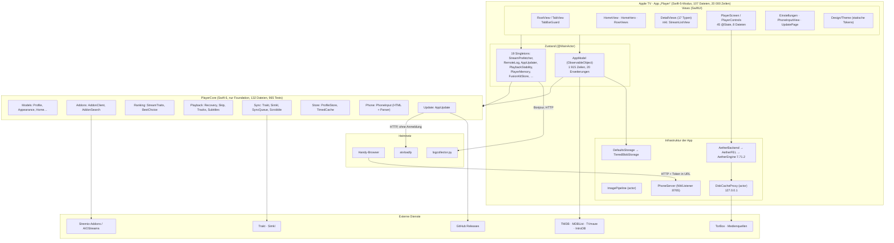
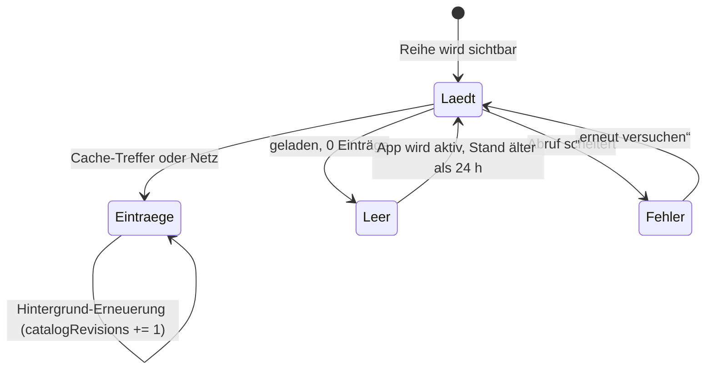
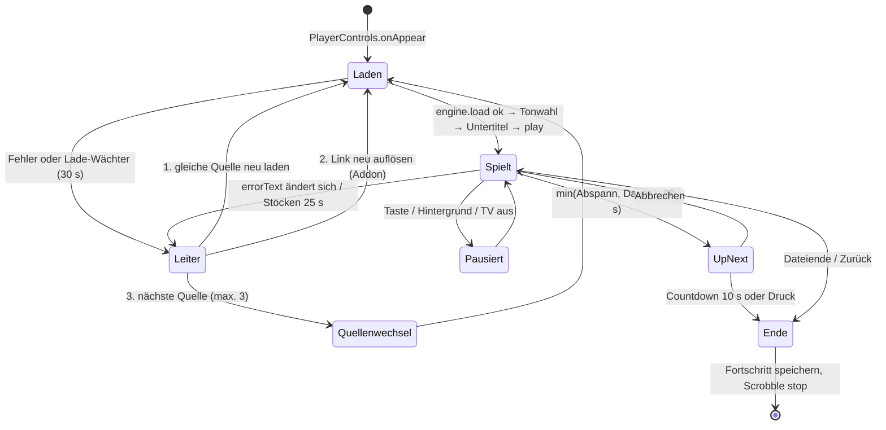
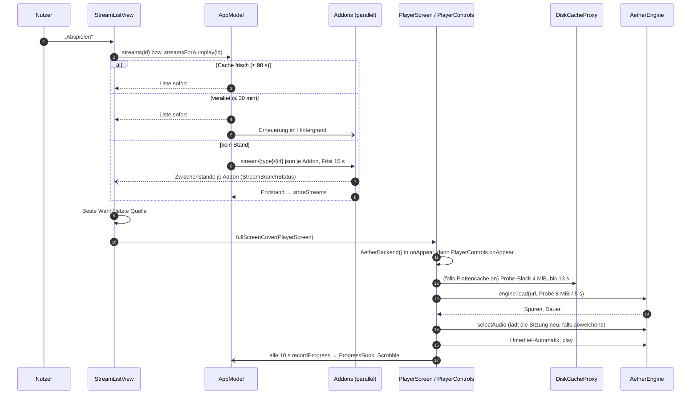
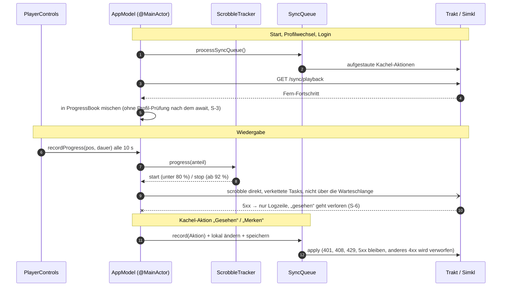
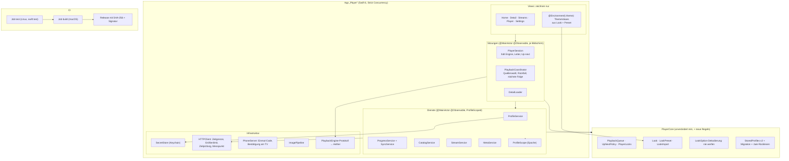
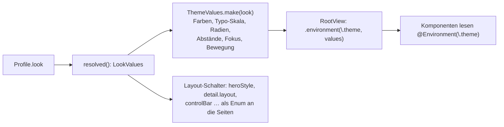

# 04 · System-Design

Stand: Branch `integ`, Commit `b2188a2` (Build 249). Alle Aussagen zum Laufzeitverhalten sind aus dem Code
**abgeleitet**. Belege mit `Datei:Zeile` stehen in [01-bestandsaufnahme.md](01-bestandsaufnahme.md) (Abläufe,
Schnittstellen, Persistenz, Nebenläufigkeit) und in [02-bugs.md](02-bugs.md); hier werden sie zu einem Bild verdichtet.

Methodik: Skill `engineering:system-design` (Anforderungen → Grobentwurf → Vertiefung → Zuverlässigkeit → Abwägungen).

## 1. Anforderungen, an denen das Design gemessen wird

| Art | Anforderung | Quelle |
|---|---|---|
| Funktional | Stremio-Addons, Wiedergabe bis Dolby Vision P7 FEL, Sync mit Trakt/Simkl, frei gestaltbare Startseite, Profile | README, Spec |
| Nicht funktional | Fokus springt nie; Startseite ruckelt nicht; Profile gehen nie verloren | Anti-Ziele der Design-Spec |
| Nicht funktional | Ein Angreifer im WLAN liest keine Schlüssel und ändert nichts | Bedrohungsmodell [N] |
| Rahmen | Kein Mac, Bauen nur in CI, jeder Gerätetest kostet 15 bis 20 Minuten, ein Entwickler | Spec §3 |
| Rahmen | tvOS 18+, unsignierte IPA, Installation über atvloadly, öffentliches Repo | README |

Die wichtigste Folge der Rahmenbedingungen: **Alles, was sich ohne Gerät prüfen lässt, muss ohne Gerät geprüft
werden.** Daran misst sich die Aufteilung App ↔ `PlayerCore` (siehe [03](03-engineering-entscheidungen.md), ADR-1).

## 2. Ist-Architektur



Beobachtungen zum Ist-Bild:

1. **Die Schichtung ist richtig gedacht, aber an drei Stellen durchlässig.** `PlayerCore` ist sauber (nur Foundation,
   keine Singletons, Swift 6). Die Ablauflogik sitzt jedoch in drei App-Typen, die sich nicht testen lassen:
   `PlayerControls`, `StreamListView` und `AppModel` (Q-1, Q-3, Q-5 in [05](05-code-review.md)).
2. **Der Zustand ist zweigeteilt.** `AppModel` hält Profil, Fortschritt und alle Caches. Daneben stehen 19 Singletons
   mit eigenem Zustand, die bei einem Profilwechsel einzeln von Hand geleert werden (`AppModel.switchProfile`). Jede
   vergessene Stelle ist ein Profil-Leck (Beispiele in [02](02-bugs.md), Bereich Sync & Profile).
3. **Drei Wege ins Heimnetz laufen ohne Schutz:** Handy-Seite, atvloadly und Fern-Log ([06](06-security-review.md)).

## 3. Datenflüsse und Zustände

### 3.1 Zustände einer Startseiten-Reihe



Jede Phase hat mindestens ein fokussierbares Element (`HomeRowPhase` in `PlayerCore`). Das ist die richtige Regel
gegen hängenden Fokus. Sie gilt aber nur für Listen-Reihen; Collection-Reihen haben keine Übergabe vom Platzhalter
zur Kachel (F-A-2).

### 3.2 Zustände der Wiedergabe



Die Leiter selbst liegt als reine Regel in `PlayerCore` (`PlaybackRecovery`) und ist getestet. Das **Ausführen** der
Leiter liegt in der View. Dort entstehen die Wiedergabe-Bugs: nach einem reparierten Erst-Ladefehler entfallen Tonwahl
und Untertitel-Automatik (W-A-1), nach einem Ersatz-Laden wird die Tonspur nicht wiederhergestellt (W-A-3).

### 3.3 Sequenz: Wiedergabe-Start



### 3.4 Sequenz: Sync



Zwei Schwächen sind am Diagramm ablesbar: **Scrobbles umgehen die Warteschlange** (kein erneuter Versuch nach App-Ende),
und **das Abholen läuft nur bei Start, Profilwechsel und Login** (ein tagelang offenes Apple TV sieht Fortschritt von
anderen Geräten nicht).

## 4. Nebenläufigkeitsmodell

| Ebene | Wer | Isolation | Geteilte Daten | Bewertung |
|---|---|---|---|---|
| Oberfläche und Zustand | Views, `AppModel`, 13 weitere Stores | `@MainActor` | Profil, Fortschritt, alle RAM-Caches | Einfach und sicher gegen Data Races. Preis: JSON-Arbeit und Sortierungen laufen auf dem Main-Thread, wenn sie nicht ausdrücklich ausgelagert sind. |
| Hintergrund-Dienste | `ImagePipeline`, `DiskCacheProxy`, `RatingsStore`, `FocusVideoCache`, `AsyncLimiter`, `TVmazeGate` | `actor` | eigener Zustand | Gut. Reentrancy über `await` ist die Fehlerquelle (Plattencache, W-A-6). |
| Reine Logik | alles in `PlayerCore` | Werttypen, `Sendable` | keine | Sehr gut, vom Compiler im Swift-6-Modus geprüft. |
| Ausnahmen | `NSCache` (`nonisolated(unsafe)`), 8 Typen `@unchecked Sendable` mit `NSLock`, statische Regex/Formatter | von Hand | Bildcache, Abbruch-Merker | Vertretbar, aber ungeprüft. |

Drei strukturelle Punkte:

1. **Die App wird im Swift-5-Modus gebaut** (`App/project.yml:47`). Die Hälfte des Codes, und genau die Hälfte mit
   Singletons und rund 23 veränderlichen `static var`, wird vom Compiler nicht auf Data Races geprüft (Q-12).
2. **Rund 100 `Task { }` ohne gehaltenen Handle.** Sie überleben die View, die sie gestartet hat. Daraus entstehen
   die Befunde „später Push auf eine andere Seite“ (F-A-1) und „Ergebnis landet im falschen Profil“ (S-3, S-4).
   Die Regel für den Umbau: Jede Aufgabe gehört entweder einer View (`.task(id:)`, endet mit ihr) oder einem Dienst
   (gehaltener Handle, Abbruch bei Profilwechsel).
3. **Profil-Epoche fehlt als gemeinsames Konzept.** `streamTasks.reset()` und `TimedCache.generation` lösen es für
   Quellen und Kataloge. Trakt-Erneuerung, Fern-Fortschritt, TMDB-Texte und der Quellen-Cache bei Addon-Änderung tun
   es nicht. Vorschlag in §7: ein `ProfileScope`, den jede profilbezogene Aufgabe nach jedem `await` prüft.

## 5. Fehler- und Retry-Strategie

Die vollständige Tabelle je Dienst steht in [01 §8](01-bestandsaufnahme.md). Bewertung:

| Dienst | Ist | Lücke | Vorschlag |
|---|---|---|---|
| Addons (Streams) | Frist je Addon 15 s, parallel, Zwischenstände, veralteter Stand bleibt | Plaketten und „Sofort abspielen“ warten auf das langsamste Addon (A-A-6); „alle leer“ sperrt 5 min global (A-A-4) | Erste Antwort zählt für Plaketten; Sperre je Titel statt global |
| Addons (Katalog), Cinemeta, TMDB, MDBList, GitHub | `URLSession.shared` **ohne eigene Zeitgrenze** (System: 60 s) | Hängender Dienst hält eine Reihe oder die Detailseite bis zu 60 s | Eine gemeinsame `URLSession` mit `timeoutIntervalForRequest = 10`, `timeoutIntervalForResource = 20`, Größenlimit (SEC-9) |
| Trakt / Simkl | 429 einmal nach `Retry-After`, 401 einmal erneuern | Scrobble-Fehler nur geloggt (S-6); dauerhafte Fehler blockieren die Warteschlange (S-8) | Scrobble `stop` über die Warteschlange; Giftnachrichten nach N Versuchen aussortieren |
| TVmaze, IntroDB, Trailerio, YouTube | kurze Fristen, Fehler kurz gemerkt | IntroDB-Antwort kann abstürzen (SEC-10) | Eingaben begrenzen, `Int(exactly:)` |
| Medienquelle | Wächter 30/25 s, Leiter in drei Stufen, 8 h Gedächtnis | Unbekannte Netzfehler landen im 8-h-Gedächtnis (W-A-5) | Nur klassifizierte Fehler merken |
| Offline | `NWPathMonitor`, Leiter wartet aufs Netz, Kataloge von Platte | Kachel-Aktionen auf TMDB-Kacheln gehen offline verloren (S-5) | ID-Auflösung in die Warteschlange legen |
| Rate-Limits | MDBList 1 h Pause, TVmaze 20/10 s, Vorladen 12 Suchen/60 s | Vorladen kennt keine Limits je Addon | Budget je Addon-Host |

Grundsatz für den Umbau: **eine** HTTP-Schicht in `PlayerCore` (`HTTPFetching` existiert bereits) mit Zeitgrenze,
Größenlimit, einheitlicher Fehlerklasse und einem Messpunkt fürs Fern-Log. Heute bauen neun Stellen ihre Anfragen selbst.

## 6. Performance (abgeleitet)

Jeder Engpass nennt Ursache, geschätzte Wirkung, Vorschlag und einen Messpunkt für das Fern-Log. Die Schätzungen sind
Größenordnungen aus dem Code, keine Messwerte. Die Messpunkte kommen in Build 1 des Plans, damit die Zahlen vor dem
Umbau vorliegen.

### 6.1 Start bis bedienbare Startseite

Ablauf (Belege in [01 §2a](01-bestandsaufnahme.md)): `AppModel.init` lädt synchron Geräte-Einstellungen, Profile und
Fortschritt, dann liest ein `Task.detached` den Katalog-Plattenstand; die erste Reihe wartet auf ihn.

| Engpass | Ursache | Geschätzte Wirkung | Vorschlag | Messpunkt |
|---|---|---|---|---|
| Synchrones Laden in `AppModel.init` | LZFSE-Entpacken und JSON-Dekodieren von `profiles.json` und `progress-*.json` auf dem Main-Thread vor dem ersten Bild | 20–150 ms, wächst mit Collections und Fortschritt | Belassen, aber messen; ab 100 ms Fortschritt nachladen | `start: profile <ms> · fortschritt <ms> · bytes` |
| Katalog-Plattenstand | bis 4 MiB JSON, danach `restore` in den Cache auf dem Main-Thread | 50–300 ms bis zur ersten Reihe | Reihen einzeln streamen oder Stand je Reihe ablegen | `start: katalog gelesen <ms> · reihen <n>` |
| Erste Bilder | je Kachel Netz/URLCache → Dekodierung (3 gleichzeitig) | sichtbare Reihe in 100–400 ms aus dem Cache | Reihenfolge: sichtbare Reihe zuerst (ist so), Hero-Bild vorab | `bild: erstes Hero-Bild <ms> nach Start` |
| `syncRemoteProgress` beim Start | mischt Fern-Fortschritt, löst `@Published progress` aus → alle Karten neu | ein Ruck 1–3 s nach Start | erst nach der ersten Ruhe (2 s) und nur bei Änderung veröffentlichen | `sync: gemischt <n> Einträge, geändert <n>` |

**Messgröße „Startzeit“:** eine Logzeile `start: bedienbar nach <ms>` beim ersten gesetzten Fokus (`LaunchFocus`).

### 6.2 Zeit bis zur ersten Quelle und ersten Plakette

| Engpass | Ursache | Geschätzte Wirkung | Vorschlag | Messpunkt |
|---|---|---|---|---|
| TMDB → IMDb vor der Suche | serielle Nachfrage bei `tmdb:`-Kacheln | +150–400 ms | ID schon beim Vorladen (350 ms Fokus) auflösen und cachen | `tmdb: imdb-ID <ms>` |
| Plaketten warten auf das langsamste Addon | Detailseite nutzt nur den Endstand (A-A-6) | bis zur Frist, also bis 15 s | Plaketten aus dem ersten Zwischenstand | `detail: Plaketten nach <ms> · schnellstes Addon <ms>` |
| Beitritt zu laufender Suche ohne Zwischenstand | `onChange` ohne Anfangswert (A-A-7) | Liste bleibt leer bis zum Ende der Suche | Anfangswert übernehmen | `quellen: erste Zeile <ms> · Beitritt ja/nein` |
| `StreamTraits.parse` mehrfach je Quelle | sechs Aufrufer, Regex wird in `parseSize` je Aufruf neu gebaut | 40 Quellen × 6 = 240 Parse-Läufe, 20–80 ms auf dem Main-Thread | Ergebnis je Stream einmal berechnen und mitführen | `quellen: ordnen <ms> für <n>` |
| Autostart wartet auf Erneuerung | `streamsForAutoplay` wartet bei veraltetem Stand die ganze Suche ab | bis 15 s vor dem Start | Frist 3 s, danach mit dem vorhandenen Stand starten | `autostart: gewartet <ms>` |

### 6.3 Zeit bis zum ersten Bild im Player

| Engpass | Ursache | Geschätzte Wirkung | Vorschlag | Messpunkt |
|---|---|---|---|---|
| Zwei Render-Durchläufe vor dem ersten Netzzugriff | Backend entsteht in `onAppear`, Laden startet im `onAppear` der Kind-View | 30–100 ms | Laden direkt beim Anlegen starten | `player: load beginnt <ms> nach Druck` |
| Zweiter Sitzungsaufbau durch die Tonwahl | `selectAudio` nach `load`, obwohl die Engine `audioSourceStreamIndex` in `load` annimmt | 0,5–2 s bei jeder Abweichung (häufig: Dolby-Digital-Vorzug) | Spurwahl vor `load` aus dem Spur-Gedächtnis, sonst nach der Probe | `ton: neu geladen ja/nein · <ms>` |
| Plattencache-Probe vor der Engine | 4-MiB-Block, Listener erst danach | 0,3–3 s (nur mit Plattencache) | Listener parallel zur Probe | `cache: probe <ms>` |
| Sprung nach Anteil erst nach Laufzeit | Start puffert bei 0, dann am Ziel | 0,5–2 s bei Trakt/Simkl-Fortsetzen | Startposition in `load` übergeben | `player: erstes Bild <ms> · Sprung <ms>` |
| Feste Pausen | 900 ms vor Quellenwechsel, 800 ms vor nächster Folge | spürbar bei jedem Wechsel | auf das Ereignis warten statt auf die Uhr | – |

### 6.4 Bild-Pipeline

`ImagePipeline` ist ein `actor` mit `NSCache`, 400 MB `URLCache` auf Platte, 20 MB im RAM (4 MB während der
Wiedergabe), 6 Verbindungen je Host, 3 Dekodierungen gleichzeitig und Downsampling auf die Anzeigegröße. Das ist
solide. Offene Punkte:

| Engpass | Ursache | Geschätzte Wirkung | Vorschlag | Messpunkt |
|---|---|---|---|---|
| Speicher langer Reihen | `RemoteImage` gibt beim Verschwinden nur Bilder ab 16 MB frei; Poster bleiben im `@State` jeder aufgebauten Zelle | hält tvOS die Zellen, sind 200 Karten etwa 280 MB | Bild beim Verschwinden immer freigeben, Cache liefert es wieder | `bild: aufgebaute Zellen <n> · RSS <MB>` alle 30 s |
| Vollbild-Dekodierung bei Fokus-Ruhe | Hintergrund nach Fokus lädt `w1280` | 10–30 ms Dekodierung je Ruhepause, fällt mit dem Aufklappen zusammen | Hero-Größe vorab für die Nachbarn der fokussierten Kachel dekodieren | `hero: Fokus-Hintergrund <id> · <ms>` (Zeile existiert) |
| Kein Größenlimit | Antwort wird ganz in den Speicher geladen (SEC-9) | ein 200-MB-„Bild“ beendet die App | 20 MB Obergrenze | `bild: verworfen, <bytes>` |

### 6.5 Arbeit pro Fokuswechsel

| Engpass | Ursache | Geschätzte Wirkung | Vorschlag | Messpunkt |
|---|---|---|---|---|
| „Weiterschauen“ sortiert je Karte neu | `route(for:)` ruft je Karte `progress.continueWatching()` (filtern, sortieren, entdoppeln) bei jedem Fokusschritt | 30 Karten × n log n; bei einigen hundert Einträgen mehrere ms je Schritt | einmal je Reihe berechnen und als Wörterbuch reichen | `fokus: Reihe neu <ms>` über `HitchDetector` |
| Vier Ruhe-Timer enden gleichzeitig | 350 ms: Hintergrund, Aufklappen, Vorladen, Fokus-Video | Lastspitze genau zu Beginn der Aufklapp-Animation | staffeln: 350 ms Hintergrund, 500 ms Aufklappen, 700 ms Vorladen | `hitch: <ms>` mit Anlass |
| 70 Views beobachten das ganze `AppModel` | `ObservableObject`: jede `@Published`-Änderung wertet alle aufgebauten Karten neu aus | Ruck bei jedem Fortschritts-Speichern und jeder Katalog-Erneuerung | `@Observable` (feldgenau), siehe ADR-2 | `hitch`-Zähler je Minute vor/nach dem Umbau |
| Kontextmenü je Karte | Menü-Inhalt wird beim Aufbau gebildet, nicht beim langen Druck | klein, summiert sich | Inhalt erst beim Öffnen bilden | – |
| Neuaufbau von Reihen und Karten je Fokusschritt (Build 4 Nacharbeit S4) | neue Anker-Closure je Reihen-Durchlauf hebelte `.equatable()` der Karten aus; `latest(forItem:)` filterte je Karte alle Fortschrittseinträge; `ForEach`-IDs je Durchlauf neu | Ruckler beim schnellen Rechts-Drücken (Gerätetest 25.11.) | stabile Anker-Aktion, Index je Titel, IDs beim Laden | `metric: home.rowBody <n> · karten <k> · fokus <m>`: **Zählwerte, keine ms** – Body-Durchläufe der Reihen (n) und Poster-Karten (k) je 5-s-Fenster mit Fokusbewegung (m), nur Startseite |

## 7. Soll-Architektur

Das Soll-Bild ändert die Schichten nicht. Es zieht die Ablauflogik aus den drei großen Typen in testbare Bausteine,
ersetzt die Handarbeit beim Profilwechsel durch ein gemeinsames Konzept und schließt die drei offenen Türen ins Heimnetz.
Begründungen, Aufwand und Migrationspfade stehen in den ADRs in [03](03-engineering-entscheidungen.md).



Was sich gegenüber dem Ist ändert:

| Ist | Soll | Nutzen |
|---|---|---|
| `AppModel` mit 31 Eigenschaften, 20 Erweiterungen | sechs Dienste, `AppModel` bleibt als dünne Fassade, bis alle Views umgestellt sind | Profilwechsel an einer Stelle; feldgenaue Beobachtung |
| 19 Singletons, von Hand geleert | Dienste erfüllen `ProfileScoped`; `ProfileScope` liefert die Epoche | späte Ergebnisse können nicht mehr im falschen Profil landen |
| Ablauflogik in `PlayerControls` und `StreamListView` | `PlayerSession`, `PlaybackCoordinator` in der App, Regeln (`PlaybackQueue`, `UpNextPolicy`) in `PlayerCore` | Wiedergabe-Abläufe unter Linux testbar, ohne Gerät |
| Schlüssel im Profil-JSON | `SecretStore` (Keychain), Profil hält Verweise | Export und Caches ohne Geheimnisse |
| neun Stellen bauen HTTP selbst | ein `HTTPClient` | Zeitgrenzen, Größenlimit, SSRF-Schutz, Messpunkte an einer Stelle |
| `Theme` als statisches `enum` | `ThemeValues` aus `Look` in der Umgebung | Presets und viele Optionen ohne Umbau jeder View |
| Tests nur lokal | `test`-Job vor `build`, Release hängt davon ab | kein Release mit roten Tests; 2 Minuten statt 20 für Logikfehler |

## 8. Architektur für die Anpassbarkeit des Aussehens

Ausgangslage ([07](07-design-analyse.md), Teil 2): rund 30 Optionen in vier Strukturen (`Appearance`,
`SourceSettings`, `PlayerComfortSettings`, `SubtitleStyle`), keine Presets, kein Versionsfeld, `Theme` ist statisch.
Ein unbekannter Enum-Wert in `Appearance` macht heute die ganze Profildatei unlesbar (D-1, S-2). **Dieser Fehler
muss vor jeder neuen Option behoben sein**, sonst zerstört eine Sicherung aus einem neueren Build die Profile eines
älteren.

### 8.1 Modell

Ein neues Profilfeld `look` neben dem bestehenden `appearance`. Gespeichert werden die **Vorlage und nur die
Abweichungen davon**:

```swift
// Packages/PlayerCore/Sources/PlayerCore/Models/Look.swift
public struct Look: Codable, Sendable, Hashable {
    public var version: Int            // LookSchema.current = 1
    public var preset: LookPresetID    // .edel, .appleTV, .infuse, .kino, .streaming
    public var overrides: LookOverrides   // alle Felder optional
    public func resolved() -> LookValues  // Vorlage, überlagert mit den Abweichungen
}

public struct LookValues: Sendable, Hashable {   // vollständig, keine Optionals
    public var global: LookGlobal      // navigation, clock, settingsLayout, accent, background,
                                       // typeScale, typeCharacter, motion
    public var home: LookHome          // heroStyle, heroInfo, heroTitle, backdropFollowsFocus, cardShape,
                                       // cardSize, corners, rowSpacing, rowTitle, cardTitles, expandPosters,
                                       // focusScale, focusBorder, focusShadow, focusGlow
    public var detail: LookDetail      // layout, descriptionLines, cast, badgeStyle, ratingStyle, sourceList
    public var player: LookPlayer      // controlBar, badges, timeDisplay, trackPanel, upNext, stillWatching
}
```

Die Feldnamen und Werte sind genau die des Konfigurators (Schema in [07 §5](07-design-analyse.md)).

Warum Vorlage plus Abweichungen statt aller Werte:

| Kriterium | Alle Werte speichern | Vorlage + Abweichungen (gewählt) |
|---|---|---|
| Alte Sicherung laden | jedes neue Feld braucht einen Standard | fehlendes Feld ist `nil`, die Vorlage liefert den Wert |
| Vorlage in einem späteren Build nachschärfen | wirkt nur bei neuen Profilen | wirkt bei allen, die den Wert nicht angefasst haben |
| „Zurücksetzen“ je Option, Anzeige „angepasst“ | Vergleich mit der Vorlage nötig | ergibt sich aus `overrides` |
| Aufwand | gering | etwas höher: zwei Strukturen je Bereich |

### 8.2 Versionierung und Kompatibilität

1. **Nie werfen.** Jede Option ist ein `String`-Enum mit `LookOption`-Protokoll. Die Dekodierung liest den Rohwert als
   `String` und bildet ihn ab; ein unbekannter Wert wird zu `nil` (Vorlage gilt) und landet in einer Liste
   `LookDecodeReport.ignored`, die einmal ins Fern-Log geht. Dieselbe Hilfe (`decodeLenient`) ersetzt die strengen
   Stellen in `Appearance` und `BadgeSettings`.
2. **`version` ist ein Hinweis, keine Sperre.** Eine höhere Version wird gelesen wie eine bekannte; unbekannte Felder
   werden ignoriert. Erst eine Umbenennung oder Bedeutungsänderung erhöht die Zahl, und dann gibt es eine Funktion
   `LookMigration.upgrade(_:from:)` mit Test je Schritt.
3. **Alte Profile.** Fehlt `look`, entsteht es einmalig aus den bestehenden Feldern:
   `Look.migrated(from: Appearance, player: PlayerComfortSettings, sources: SourceSettings)` mit Vorlage `.edel` und
   Abweichungen für alles, was der Nutzer heute anders eingestellt hat. Die alten Felder werden zwei Builds lang weiter
   geschrieben, damit ein Zurückgehen auf den vorigen Build nichts verliert.
4. **Zuordnung alter Werte** (wird als Tabelle mit Test festgeschrieben):

   | Alt | Neu |
   |---|---|
   | `Appearance.navigation` `sidebar`/`top` | `global.navigation` `seitenleiste`/`oben` |
   | `Appearance.accent` `blue`, `purple`, `pink`, `orange`, `green`, `white` | `global.accent` `blau`, `violett`, `koralle`, `koralle`, `salbei`, `weiss` |
   | `Appearance.cardSize` | `home.cardSize` `klein`/`mittel`/`gross` |
   | `Appearance.heroEnabled == false` | `home.heroStyle = aus` |
   | `Appearance.expandPosters` | `home.expandPosters` |
   | `Appearance.badges.style` `text`/`logo` | `detail.badgeStyle` `text`/`logos` |
   | `PlayerComfortSettings.trackPanelStyle` `topBar`/`bottomBar`/`menu` | `player.trackPanel` `seite`/`unten`/`mitte` ([C]: `topBar` hat keine genaue Entsprechung und wird zu `seite`; die Zuordnung wird nach dem Export geprüft) |
   | `SourceSettings.appBadges` | bleibt eigenes Feld, `detail.sourceList` steuert nur die Form |

   Inhaltliche Optionen bleiben, wo sie sind: `heroRowID`, `ratingSources`, `posterBadges`, `addonImages`,
   `prefetchStreams`. `Look` enthält nur Aussehen.

### 8.3 Laufzeit: vom Modell zur View



- `ThemeValues` wird **einmal je Profil- oder Look-Änderung** berechnet, nicht je View-Auswertung. Es ist `Equatable`,
  damit SwiftUI unveränderte Zweige überspringt.
- Das statische `Theme` bleibt als Standardwert der Umgebung bestehen. So lassen sich Bildschirme einzeln umstellen,
  und jeder Build bleibt lauffähig.
- Layout-Varianten (Hero-Stil, Detail-Layout, Steuerleiste) sind Enums mit je einer eigenen View-Variante. Sie werden
  nicht über viele kleine `if` in einer View gemischt, damit sich die fokussierte View beim Umschalten einer Option
  nie unbemerkt ändert.
- Die Zuordnung `LookValues → Zahlen` (Skalierung 1,05, Radius 14, Dauer 0,24 s) liegt in `PlayerCore` als reine
  Tabelle `LookMetrics` und ist dort getestet. Die Farben liegen in der App, weil `Color` SwiftUI braucht.

### 8.4 Import aus dem Konfigurator

Der Konfigurator exportiert:

```json
{ "schema": "player.appearance.preset", "version": 1, "preset": "edel", "modified": true,
  "exportedAt": "2026-11-22T21:00:00.000Z",
  "values": { "global": { … }, "home": { … }, "detail": { … }, "player": { … } } }
```

Zwei Wege in die App:

1. **Als Standard im Build.** `docs/design/konfigurator/export.json` ist die Quelle für die Vorlage „Edel“. Ein
   Test in `PlayerCore` liest die Datei als Fixture und prüft, dass `LookPreset.edel.values` genau diesen Werten
   entspricht. So bleibt, was der Nutzer im Konfigurator gewählt hat, und der Code beweisbar gleich.
2. **Zur Laufzeit über die Handy-Seite.** `PhoneImportDetect` erkennt das Schema-Feld im Schnell-Import;
   `LookImport.parse(_ data: Data) -> (look: Look, report: LookDecodeReport)` wandelt `values` in `overrides`
   gegenüber der genannten Vorlage um; `PhoneCommand.look(Look)` setzt `profile.look`. Unbekannte Werte werden
   ignoriert und auf der Handy-Seite als Hinweis gezeigt („3 Werte kannte diese App-Version nicht“). Der Import ändert
   nur das Aussehen und nie Schlüssel oder Addons; er braucht deshalb keine Bestätigung am Fernseher, anders als die
   Wiederherstellung einer Sicherung.

### 8.5 Testbarkeit

| Test (PlayerCore, unter Linux) | Prüft |
|---|---|
| `lookDecodesUnknownValueAsPresetDefault` | unbekannter Rohwert → `nil`, Bericht nennt das Feld, nichts wirft |
| `lookMissingInOldProfileMigratesFromAppearance` | Fixture `main-profiles-v1.json` → erwartete Vorlage und Abweichungen |
| `everyPresetResolvesCompletely` | alle fünf Vorlagen liefern vollständige `LookValues` |
| `overridesRoundTrip` | kodieren → dekodieren → gleich; leere Abweichungen ergeben `{}` |
| `configuratorExportMatchesEdelPreset` | `export.json` entspricht der Vorlage im Code |
| `lookImportIgnoresForeignSchemaAndHigherVersion` | fremdes Schema → Fehlertext; höhere Version → gelesen, Bericht |
| `profileWithFutureLookStillLoads` | Profil mit unbekannten Look-Feldern und -Werten lädt vollständig |
| `lookMetricsAreMonotonic` | klein < mittel < groß; Bewegung „aus“ = 0 s |

## 9. Was ich bei Wachstum neu bewerten würde

- **Ein zweites Gerät oder iCloud-Sync** (heute Nicht-Ziel): dann reicht „ganzes `StoredProfiles` in einen Block“ nicht
  mehr. Das Soll-Bild bereitet das vor, weil `ProfileService` die einzige Schreibstelle wird.
- **Mehr als etwa 2 000 Fortschritts-Einträge je Profil:** `ProgressBook` als ein JSON-Block wird dann zu groß für
  UserDefaults (S-10). Dann Aufteilung in Jahres-Blöcke oder SQLite.
- **Ein zweites Wiedergabe-Backend:** heute hängen 13 Dateien direkt an `AetherFEL`. Erst wenn es konkret wird, lohnt
  die volle Kapselung (ADR-1).

---

## Anhang: Performance-Detailtabellen aus der Gegenprüfung

Die folgenden Tabellen sind die geprüften Einzelbeobachtungen der vier Bereiche. Sie sind die Grundlage für Abschnitt 6.

### Wiedergabe

### Performance: Zeit bis zum ersten Bild

Alle Zeitangaben sind Schätzungen aus Grenzwerten im Code, nicht gemessen. Vorhandener Messpunkt: eine Logzeile je Start, „Startzeit: Auswahl→Link · Link→Bild · Bild→spielt · gesamt“ (`Packages/PlayerCore/Sources/PlayerCore/Playback/LoadWatchdog.swift:173-182`, gesetzt in `App/Sources/Views/Player/PlayerStability.swift:51`, `:113`, `:118`). Sie teilt „Link→Bild“ nicht weiter auf.

#### Schrittfolge

| # | Schritt | Ort | Ablauf |
|---|---|---|---|
| 1 | Tastendruck, `markTap` | `App/Sources/Views/DetailViews.swift:779`, `:1063` | Beginn der Messung |
| 2 | Player erscheint, Backend (`AetherEngine()`) wird in `onAppear` angelegt | `App/Sources/Views/PlayerScreen.swift:104-110` | seriell, synchron auf dem Main-Thread |
| 3 | Zweiter Render-Durchlauf: `PlayerControls` erscheint, startet `loadTask` | `App/Sources/Views/PlayerScreen.swift:358-359` | seriell nach 2 |
| 4 | Plattencache-Weg (nur wenn an): alte Dateien löschen, freien Platz messen | `App/Sources/Playback/DiskCacheProxy.swift:513-514` | seriell, synchron auf dem Actor |
| 5 | Plattencache-Probe: Block 0 (4 MiB) vom Ursprung, Grenze 13 s | `App/Sources/Playback/DiskCacheProxy.swift:190-191` | seriell vor der Engine |
| 6 | Listener-Start, Wartegrenze 3 s | `App/Sources/Playback/DiskCacheProxy.swift:529`, `:637` | seriell nach 5 (bewusst, Kommentar Zeile 528) |
| 7 | Profil-5-Vorprüfung (nur X-Ray an, unbekannte Quelle), Grenze 1,5 s | `App/Sources/Playback/XRayProfile5.swift:19`, `:59-64` | seriell vor der Engine |
| 8 | `engine.load` mit 8 MiB / 5 s Analyse | `App/Sources/Playback/PlaybackEngine.swift:208-209`, `:220` | seriell; der eigentliche Hauptanteil |
| 9 | Tonwahl der App, bei Abweichung `selectAudio` (zweiter Sitzungsaufbau) | `App/Sources/Views/PlayerScreen.swift:432-435` | seriell nach 8 |
| 10 | Untertitel-Wahl, `play()` | `App/Sources/Views/PlayerScreen.swift:438-442` | seriell, schnell |
| 11 | Addon-Untertitel (Datei-Hash bis 4 s, Abfrage, Dateien laden) | `App/Sources/Views/PlayerScreen.swift:440`, `App/Sources/Views/Player/AddonSubtitleLoader.swift:28-36` | parallel, hält den Start nicht auf |
| 12 | Sprung nach Anteil, sobald die Laufzeit da ist | `App/Sources/Views/PlayerScreen.swift:376-381` | nach 8, zweites Puffern |

#### Engpässe

| Ort | Ursache | geschätzte Wirkung | Vorschlag | Fern-Log-Messpunkt |
|---|---|---|---|---|
| `App/Sources/Playback/DiskCacheProxy.swift:190-191` | Mit Plattencache wird ein ganzer 4-MiB-Block geladen, bevor `engine.load` beginnt | 0,3–3 s je nach Leitung (bei 16 Mbit/s rund 2 s), Grenze 13 s | Probe mit kleinem Range (z. B. 64 KiB) für Größe und Range-Unterstützung, Rest von Block 0 im Hintergrund | Zeit zwischen „Laden …“ und „Plattencache an ·“ als Millisekunden in dieselbe Zeile |
| `App/Sources/Views/PlayerScreen.swift:432-435` | Weicht die Wahl der App (Dolby-Digital-Vorzug, Spur-Gedächtnis) von der Vorwahl der Engine ab, baut `selectAudio` die Sitzung direkt nach dem Laden neu auf | plausibel 0,5–2 s zusätzlich, nur bei Abweichung | Gemerkte bzw. bevorzugte Spur schon beim Laden mitgeben, falls die Engine das anbietet (Engine-Schnittstelle, hier nicht prüfbar); sonst nur die Sprache genauer vorgeben | Zeile „Tonwahl beim Start: Wechsel von X auf Y“ plus Dauer bis zum nächsten ersten Bild |
| `App/Sources/Views/PlayerScreen.swift:376-381` | Stand nur als Anteil: Start puffert bei 0 und springt erst danach | ein zusätzlicher Sprung, 1–3 s, nur bei Titeln mit Sync-Stand ohne lokale Laufzeit | Laufzeit aus den Metadaten (`runtimeMinutes`) für eine geschätzte Startstelle nutzen und nach dem Laden nur noch nachführen | „Sprung nach Anteil: Ziel … s“ mit Zeit bis zur Ankunft |
| `App/Sources/Playback/PlaybackEngine.swift:221-225`, `App/Sources/Views/PlayerScreen.swift:690-691` | Laden über den Cache scheitert → zweites vollständiges Laden über die direkte Adresse; meldet die Engine den Fehler, bricht `recover` auch diesen Versuch ab und wiederholt den Start | ein bis zwei volle Ladezeiten, dazu ein verbrauchter Leiter-Versuch; nur im Fehlerfall | Im Rückfall-Fenster den Engine-Fehler nicht an die Leiter geben | vorhandene Zeile „Laden über den Plattencache fehlgeschlagen“ zählen |
| `App/Sources/Views/PlayerScreen.swift:715`, `:758`, `App/Sources/AppModel+Reresolve.swift:16` | Link neu auflösen fragt das Addon frisch, im Player ohne eigene Zeitgrenze | Dauer einer Addon-Antwort (Sekunden), nur im Fehlerfall | Zeitgrenze im Player und Lade-Hinweis | Dauer in der Zeile „Neu auflösen bei …“ ergänzen |
| `App/Sources/Views/DetailViews.swift:1061`, `:1094`, `:1145` | Feste Pausen vor der nächsten Quelle (900 ms) und der nächsten Folge (800 ms) | 0,8–0,9 s je Wechsel | Auf das tatsächliche Schließen des alten Players warten statt fest zu schlafen | Zeitstempel „Wechsel … auf“ gegen „Laden …“ |
| `App/Sources/Views/Player/PlayerExit.swift:52-66` | Geordneter Ausstieg: 0,25 s Abdeckung, dann 0,2–1 s Wartezeit, höchstens 6 s | 0,5–1,3 s je Ausstieg, betrifft Wechsel und Verlassen, nicht den ersten Start | So lassen (verhindert Bildfehler beim Moduswechsel); nur die Höchstgrenze beobachten | vorhandene Zeile „Ausstieg: … (Wartezeit … s)“ |
| `App/Sources/Views/PlayerScreen.swift:104-110`, `:358-359` | Backend erst in `onAppear`, Laden erst im `onAppear` des zweiten Views | zwei Render-Durchläufe, geschätzt unter 100 ms | Geringer Nutzen; nur angehen, wenn die Messung es zeigt | Zeit „Player erscheint → Laden“ loggen |
| `App/Sources/Playback/XRayProfile5.swift:59-64` | Vorprüfung vor dem Laden, nur mit X-Ray und unbekannter Quelle | bis 1,5 s | So lassen (Diagnose-Funktion) | vorhandene Zeile „P5-Vorprüfung … ms“ |

Stichproben der Gegenprüfung: Punkte 2, 3, 5, 6, 8, 9, 12 der Schrittfolge und alle Zeilen der Engpass-Tabelle wurden an den genannten Stellen nachgelesen; die Grenzwerte stammen aus `Packages/PlayerCore/Sources/PlayerCore/Playback/DiskCache.swift:127-153` und `Packages/PlayerCore/Sources/PlayerCore/Playback/ModeSwitchExit.swift:9-27`. Zwei Korrekturen am Erstbericht: Der Listener-Start nach der Probe ist eine bewusste Entscheidung (Kommentar `DiskCacheProxy.swift:528`) und dauert im Normalfall Millisekunden – kein lohnender Hebel. Und die Tonwahl lässt sich nicht einfach vor das Laden ziehen, weil die Spurliste erst nach dem Laden bekannt ist; der Vorschlag setzt eine passende Ladeoption der Engine voraus.

Wichtigster fehlender Messpunkt: „Link→Bild“ in Cache-Probe, Vorprüfung, `engine.load` und Tonwechsel aufteilen. Erst damit lässt sich sagen, welcher der Schritte 5 bis 9 den Start wirklich bestimmt.

### Fokus & Navigation

### Performance-Beobachtungen

Alle zwölf Zeilen des Erstberichts wurden stichprobenhaft am Code geprüft; keine war falsch, zwei Schätzungen wurden vorsichtiger gefasst (P1, P12). Zahlen sind Schätzungen ohne Messung.

| Ort | Ursache | geschätzte Wirkung | Vorschlag | Fern-Log-Messpunkt |
|-----|---------|--------------------|-----------|--------------------|
| `App/Sources/Views/RowViews.swift:245`, `:155`, `:43`; `Packages/PlayerCore/Sources/PlayerCore/Progress/WatchProgress.swift:76` | P1: Jede Fokusbewegung wertet `HomeRowView.body` neu aus. In „Weiterschauen“ ruft `route(for:)` je Karte `continueWatching()` auf (alle Einträge filtern, sortieren, entdoppeln), dazu zweimal im Aufgaben-Schlüssel. | Bei einigen hundert Einträgen grob 1–10 ms je Fokusschritt auf dem Main-Thread, nur in dieser Reihe. | Einmal je `body` berechnen und als Wörterbuch `item.id → Eintrag` nachschlagen. | Dauer von `body` der Weiterschauen-Reihe je Fokusschritt (Signpost „Reihe neu“ mit ms und Kartenzahl). |
| `App/Sources/Views/HomeHero.swift:27`; `App/Sources/Views/RowViews.swift:410`; `App/Sources/Views/FocusVideo.swift:492`; `App/Sources/ImagePipeline.swift:517`; `App/Sources/StreamPrefetcher.swift:138` | P2: Alle Ruhe-Timer enden fast gleichzeitig (350 ms Hintergrund + Info, 350 ms Aufklappen samt Programm-Scroll, 350 ms GIF, 400 ms Video, Quellen-Vorladen). | Lastspitze genau beim Start der Aufklapp-Animation (Vollbild-Dekodierung, Überblendungen, Netz-Start). | Staffeln (z. B. Hintergrund 350, Aufklappen 450, Video 600). | „ruckler“-Zeilen mit Notiz „Fokus …“: Abstand zur Fokuszeit (Häufung bei 350–450 ms). |
| `App/Sources/Views/RowViews.swift:119`, `:124`, `:509`; `Packages/PlayerCore/Sources/PlayerCore/Import/ReadyPackages.swift:80` | P3: `FolderTile` ist nicht `.equatable()`; je Fokusschritt für jede aufgebaute Kachel `tileStyle`, dazu `CollectionArtStats`/`PackageArtStats` über alle Ordner und `model.collection(id)`. | 1–5 ms je Schritt bei 20–40 Kacheln. | `FolderTile: Equatable`, Statistik nur bei geänderter Ordnerliste berechnen. | Dauer von `body` einer Collection-Reihe je Fokusschritt. |
| `App/Sources/Views/RowViews.swift:616`, `:622`; `App/Sources/Views/QualityBadges.swift:76`; `Packages/PlayerCore/Sources/PlayerCore/Progress/WatchProgress.swift:86`, `:93` | P4: Jede Karte hat mehrere Views mit `@EnvironmentObject AppModel`; jede `@Published`-Änderung wertet alle aufgebauten Karten neu aus. `cardState` läuft je Karte zweimal (Overlay und `topInset`) und durchsucht für Serien alle Einträge (`latest(forItem:)`). | Je Modell-Änderung bei 60–100 Karten und einigen hundert Einträgen 10–50 ms; trifft nach dem Player genau die Fokus-Rückkehr. | Kartenzustand je Reihe einmal vorberechnen (Wörterbuch) oder Index `item.id → neuester Eintrag` in `WatchProgress`. | Ruckler-Zeile direkt nach „Player geschlossen“ mit Zahl aufgebauter Karten. |
| `App/Sources/Views/TileContextMenu.swift:19`, `:20`; `App/Sources/Views/RowViews.swift:257` | P5: Der Menü-Inhalt wird beim Aufbau des Modifiers gebildet; `model.tileMenu(for:)` läuft je Karte bei jeder Neuauswertung der Reihe, nicht erst beim langen Druck. | Klein je Karte, summiert sich mit P1 je Fokusschritt. | Menüpunkte in einer eigenen View mit eigenem Zustand bilden (Auswertung erst beim Öffnen). | Zähler „tileMenu-Aufrufe je Fokusschritt“. |
| `App/Sources/Views/RowViews.swift:25`, `:256`; `App/Sources/PlayerApp.swift:16`, `:36` | P6: Fokuswert ist `Route` mit eingebettetem `MetaPreview` bzw. `PlayRequest` (samt Folgenliste); jeder Vergleich/Hash geht über alle Zeichenketten. | Mikrosekunden je Karte. | Eine ID als Fokuswert (entschärft auch „Am Gerät prüfen“ Punkt 3). | Kein eigener Messpunkt nötig. |
| `App/Sources/Views/QualityBadges.swift:65`; `App/Sources/Views/HomeView.swift:214` | P7: Je aufgebauter Poster-Karte ein `onGeometryChange` mit Rahmen in Bildschirmkoordinaten; die Umrechnung läuft bei jedem Scroll-Frame für alle Karten. | Beim Halten von ▼ 60–120 Auswertungen je Frame; zusammen messbar auf älteren Geräten. | Sichtbarkeit je Reihe statt je Karte bestimmen. | Bildrate/Ruckler-Zeilen während gehaltenem ▼ über 10 Reihen. |
| `App/Sources/Views/TabBarGuard.swift:141`, `:150` | P8: Breitensuche über bis zu 4000 Views auf dem Main-Thread je Prüfung. | Nur bei Navigation oben nach Pop, Player-Ende oder gescheitertem ▲ mit Leiste außerhalb; unkritisch (Vorprüfung in `TabBarGuard.swift:125`). | Belassen; gefundenen ScrollView je Seite merken. | Dauer von `pageScrollView()` in der „nav“-Reparaturzeile. |
| `App/Sources/ImagePipeline.swift:415`, `:465`; `App/Sources/Views/RowViews.swift:359` | P9: `RemoteImage` gibt beim Verschwinden nur Bilder ab 16 MB frei; Poster bleiben im Zustand jeder noch aufgebauten Zelle. | Baut tvOS Zellen ab: unkritisch. Sonst wächst der Speicher mit jeder durchgeblätterten Karte außerhalb des Cache-Budgets. | Am Gerät klären (Punkt 12); ggf. Schwelle senken. | Speicherangabe der „ruckler“-Zeilen vor/nach 200 durchgeblätterten Karten. |
| `App/Sources/Views/HomeHero.swift:190`; `App/Sources/Views/FocusVideo.swift:185`; `App/Sources/Views/RowViews.swift:282` | P10: Unbegrenzte Wörterbücher (`HeroDetailsCache.all`, `loggedStarts`, `CollectionRowLog.last`). | Wächst über die Laufzeit um wenige hundert Byte bis KB je Eintrag; niedrig. | Auf einige hundert Einträge begrenzen. | Eintragszahl einmal täglich loggen. |
| `App/Sources/Views/FocusVideo.swift:80`, `:85` | P11: Fokusverlust bricht den laufenden Video-Download ohne Teilstand ab; eine neue Adresse verdrängt die alte. | Große Videos werden bei langsamer Leitung nie fertig, jeder Versuch lädt von vorn. | Download beim Fokusverlust weiterlaufen lassen oder mit Range fortsetzen. | „Fokus-Video“-Zeilen: Abbrüche je Adresse und geladene Bytes. |
| `App/Sources/Views/Home/AddRowBrowser.swift:28`; `App/Sources/Views/Home/HomeManagerView.swift:109`; `App/Sources/Views/Home/HomeRowsSession.swift:116` | P12: Der Ziel-Closure von `navigationDestination(isPresented:)` wird bei jeder Auswertung des Verwalters gebaut; `AddRowBrowser.init` ruft dabei `session.catalog()`, dessen Cache-Vergleich jedes Mal `CatalogInputs` aufbaut. | Im Verwalter je Fokusschritt ein Strukturvergleich großer Arrays; spürbar erst bei vielen Addons/Kit-Dateien. | Anfangsauswahl erst in `onAppear` des Browsers bestimmen. | Dauer von `catalog()` und Aufrufzahl je Verwalter-Sitzung. |

### Addons & Startseite

### Performance: Zeit bis zur ersten Quelle und ersten Plakette

#### Ablauf Quellenliste (erste Quelle)
1. Die Liste ruft in ihrer `.task` `model.streams` bzw. `streamsForAutoplay` (`App/Sources/Views/DetailViews.swift:841`–`843`).
2. Cache-Treffer (frisch oder veraltet) → sofort, ohne Netz (`App/Sources/AppModel.swift:476`–`481`). Veraltet stößt die Erneuerung an (`App/Sources/AppModel+StreamRevalidate.swift:21`); bei Autostart wartet `streamsForAutoplay` zusätzlich auf sie (`App/Sources/AppModel+StreamRevalidate.swift:54`) – das kostet die volle Suchzeit bis zum langsamsten Addon.
3. Läuft schon eine Suche → Beitritt, Rückkehr erst am Ende (`App/Sources/AppModel.swift:487`–`492`); Zwischenstände erst beim nächsten fertigen Addon (A-A-7).
4. Sonst neue Suche: alle Addons **parallel**, je eigene Frist aus dem Profil (Standard 15 s, Auswahl 8–45 s, geklemmt auf 3–120 s) (`Packages/PlayerCore/Sources/PlayerCore/Addons/AddonSearch.swift:89`–`101`, `163`–`176`).
5. Nach jedem fertigen Addon: `onUpdate` → Hauptthread → `StreamSearchStatus.update` → `onChange` → Liste aus dem Zwischenstand (`App/Sources/AppModel+StreamSearch.swift:42`–`47`, `113`–`117`). Erste sichtbare Quelle ≈ Antwortzeit des schnellsten Addons.
6. Ende: `storeStreams` (Cache, Plaketten-Cache), die Liste wird durch das Endergebnis ersetzt (`App/Sources/AppModel.swift:511`, `667`–`700`).

**Seriell davor:** bei TMDB-Kacheln die Nachfrage TMDB → IMDb-ID (`App/Sources/AppModel.swift:401`, auf der Detailseite `App/Sources/Views/DetailViews.swift:198`); danach laufen Quellen, Bewertungen und Metadaten parallel (`DetailViews.swift:211`–`231`).

#### Ablauf Plaketten
- **Detailseite (Film):** IMDb-ID (seriell) → Cache-Blick (`DetailViews.swift:201`) → sonst eigene Aufgabe mit `model.streams` (`DetailViews.swift:211`–`217`); Plakette erst nach dem **langsamsten** Addon bzw. der Frist (A-A-6). Serien: keine Quellenabfrage auf der Detailseite.
- **Poster:** Kachel sichtbar → 400 ms Ruhe (`Packages/PlayerCore/Sources/PlayerCore/Models/VisiblePrefetchPlan.swift:20`) → IMDb-ID → `model.streams(caller: .visiblePrefetch)` → `storeStreams` → `streamsStored` → `onReceive` der Kachel (`App/Sources/StreamPrefetcher.swift:303`–`316`, `App/Sources/Views/QualityBadges.swift:59`, `115`). Höchstens 4 gleichzeitig, aus dem gemeinsamen Budget von 12 Suchen/60 s abzüglich Reserve 4 (`StreamPrefetcher.swift:22`–`23`), und keine Starts, solange eine Seite selbst sucht (`StreamPrefetcher.swift:320`).
- **Fokus-Vorladen:** 350 ms Ruhe → höchstens 2 gleichzeitig, 2 wartend (`StreamPrefetcher.swift:19`–`20`, `168`–`185`).

#### Engpässe

| Ort | Ursache | geschätzte Wirkung | Vorschlag | Fern-Log-Messpunkt |
|---|---|---|---|---|
| `App/Sources/Views/DetailViews.swift:212` | Technik-Plaketten und „Sofort abspielen“ warten auf das Endergebnis aller Addons (A-A-6) | bis zur Addon-Frist (Standard 15 s) statt Antwortzeit des schnellsten Addons | Zwischenstand aus `StreamSearchStatus` für `best`/Wahl nutzen | vorhandene Zeile `Plaketten nach … ms` um „schnellstes Addon nach … ms“ ergänzen |
| `App/Sources/AppModel+StreamSearch.swift:113` | Beitritt zu laufender Suche übernimmt vorhandenen Zwischenstand nicht (A-A-7) | leere Liste bis zum nächsten fertigen Addon, bei zwei Addons bis zur Frist | `onChange(…, initial: true)` | ms vom Erscheinen der Liste bis zur ersten Zeile, mit Kennzeichen „Beitritt“ |
| `App/Sources/StreamPrefetcher.swift:22` | Budget 12 Suchen/60 s, davon 4 für den Fokus reserviert | rund 8 Kachel-Starts je Minute; 16 sichtbare Kacheln brauchen etwa 2 min bis zur letzten Plakette (abgeleitet) | Budget erst an echten Ratenfehlern der Addons ausrichten; Kacheln der fokussierten Reihe zuerst | Wartezeit je Kachel von „sichtbar“ bis „Start“ mit Grund (Budget/Plätze/Pause) |
| `App/Sources/AppModel.swift:508` | Pause nach „alle Addons leer“ auch bei einem einzelnen quellenlosen Titel (A-A-4) | bis zu 5 min keine neuen Plaketten, kein Fokus-Vorladen | Pause nur bei Fehlern oder mehreren leeren Titeln | Zeile beim Setzen und Aufheben der Pause |
| `App/Sources/AppModel+StreamRevalidate.swift:54` | Autostart wartet bei veraltetem Stand auf die vollständige Erneuerung | zusätzliche Suchzeit bis zum langsamsten Addon vor Weiterschauen / nächster Folge | nur das Addon der gemerkten Quelle abwarten | ms von `Start aus veraltetem Stand` bis zum Start der Wiedergabe |
| `App/Sources/AppModel.swift:401` | TMDB → IMDb-ID seriell vor der Quellensuche (nur beim ersten Mal je Titel) | eine TMDB-Antwortzeit, abgeleitet einige hundert ms | IDs der sichtbaren Reihe gebündelt vorab nachschlagen | Dauer der Nachfrage in der `tmdb`-Kategorie |
| `Packages/PlayerCore/Sources/PlayerCore/Ranking/StreamTraits.swift:142` | `parseSize` übersetzt sein Muster bei jedem Aufruf neu; `StreamTraits.parse` läuft je Quelle mehrfach auf dem Hauptthread (Plaketten-Cache, Detailseite, Rangfolge, Listenzeilen) | bei mehreren hundert Quellen spürbar (nur am Gerät messbar) | Merkmale einmal je Quelle berechnen und mitführen; Muster als Konstante | Dauer von `storeStreams` + `orderedStreams` je Liste mit Quellenzahl |
| `App/Sources/AppModel+MetaAddon.swift:10` | Cinemeta ohne eigene Frist (A-A-11) | nur bei hängendem Dienst: bis zur Standardgrenze der Sitzung | begrenzte, geteilte Abfrage | ms je `meta`-Abfrage mit Quelle |
| `Packages/PlayerCore/Sources/PlayerCore/Services/YouTubeResolver.swift:83` | Clients nacheinander, keine Gesamtfrist (A-A-17) | bis etwa 24 s bis „Trailer nicht verfügbar“ | Gesamtfrist | ms je Schritt (trailerio, Besucher-Token, je Client) |

Stichprobenhaft geprüft: Parallelität und Fristen der Addon-Suche (`AddonSearch.swift:133`–`176`), Konstanten des Vorladers (`StreamPrefetcher.swift:19`–`27`), Entprellung der Kacheln (`VisiblePrefetchPlan.swift:20`), Ablauf der Detailseite (`DetailViews.swift:195`–`231`) und der Quellenliste (`DetailViews.swift:836`–`899`). Nicht nachgeprüft: die genaue Zahl der `parse`-Aufrufe je Quelle und die Aussage des Erstberichts, eine Hintergrund-Erneuerung halte das Kachel-Vorladen an (folgt aus `caller == .page` als Standardwert, `AppModel.swift:473`, `485`).

### Addons & Startseite

### Performance-Beobachtungen

#### Start bis bedienbare Startseite (Schrittfolge)

Schritte 1 bis 4 laufen synchron auf dem Main-Thread vor dem ersten Frame.

1. `PlayerApp` legt `AppModel()` an (`App/Sources/PlayerApp.swift:6`).
2. `AppModel.init` (`App/Sources/AppModel.swift:40`–`69`): Geräte-Einstellungen lesen (`:46`), Profile lesen und dekodieren (`:58`), Fortschritt lesen (`:60`), Stores anhängen (`:61`–`:64`).
3. `FusionKitStore.attach` (`App/Sources/FusionKitStore.swift:46`–`60`): Link-Liste, Dateilisten des Kits von Platte (`:55`–`:57`), `sync()` → `ensureSettings()` → je gewählter Kit-Quelle Datei lesen und zerlegen (`:223`–`:225`, `:287`–`:289`), `FusionKitSync.apply`, ggf. Profil schreiben (`:405`).
4. `restoreCatalogSnapshot()` stößt das Lesen des Plattenstands abseits des Main-Threads an (`App/Sources/AppModel+CatalogDisk.swift:39`).
5. Erster Frame: `HomeView`. Gleichzeitig starten Hero-Task (`App/Sources/Views/HomeView.swift:71`), Vorladen (`:82`) und je sichtbarer Reihe `homeRowItems` (`App/Sources/Views/RowViews.swift:47`); alle warten in `awaitCatalogSnapshot()` (`AppModel+CatalogDisk.swift:50`).
6. Plattenstand da: Reihen füllen sich aus dem Cache, jede gezeigte Reihe stößt eine Erneuerung an (`App/Sources/AppModel+CatalogCache.swift:15`). Ohne Plattenstand: Netzabrufe, Vorladen begrenzt (`App/Sources/AppModel+HomeRows.swift:47`).
7. Parallel: `syncRemoteProgress()` (`PlayerApp.swift:10`), `FusionKitStore.refresh()` (`FusionKitStore.swift:59`), ggf. `loadPackageArt()` (`:401`), „Heute neu“ mit bis zu 50 Serien (`App/Sources/AppModel+Upcoming.swift:27`).

#### Bild-Pipeline (Kurzfassung)

Ablauf je Bild: Speichercache (`ImagePipeline.swift:77`) → Fehler-Sperre (`:79`) → laufende Anfrage teilen (`:80`) → Größenvariante laden, sonst Original (`:284`–`:296`) → Dekodieren mit höchstens 3 Plätzen bei Priorität `.utility` (`:291`–`:293`, `:308`–`:315`). Plattencache 400 MB mit `returnCacheDataElseLoad` (`:49`–`:51`). Speichercache höchstens 160 MB (`Packages/PlayerCore/Sources/PlayerCore/Services/ImageCacheBudget.swift:10`), bei Wiedergabe und Speicherwarnung geleert (`ImagePipeline.swift:124`, `:129`).

#### Engpässe

Alle Wirkungen sind Schätzungen aus dem Code, keine Messungen. Jede Zeile wurde am Code gegengeprüft.

| Ort | Ursache | geschätzte Wirkung | Vorschlag | Fern-Log-Messpunkt |
|---|---|---|---|---|
| `App/Sources/FusionKitStore.swift:223`, `:288` (P-1) | Gewählte Kit-Dateien werden beim Start synchron auf dem Main-Thread gelesen und zerlegt; `FusionImport.parse` läuft zweimal über die Daten (`FusionImport.swift:140`, `:150`). `loadPackageArt` macht dasselbe bewusst abseits (`FusionKitStore.swift:323`–`:327`). | 5–20 ms je Datei, bei mehreren gewählten Dateien 30–150 ms vor dem ersten Frame | Startpfad wie `loadPackageArt` in `Task.detached`; die Reihen bleiben bis dahin über `unknown` stehen | „kit Start: n Dateien in ms“ um `attach` |
| `App/Sources/AppModel.swift:58`, `:60`, `:234`–`:242`; `App/Sources/FusionKitStore.swift:51` (P-2) | Profil und Fortschritt synchron im `init`; jedes `update` kodiert und schreibt alle Profile synchron und löst über `$stored` einen Kit-Abgleich aus | 10–50 ms je Lesen/Schreiben bei großen Profilen (viele Collections) | Gebündelt abseits des Main-Threads schreiben; `sync()` nur bei Änderungen an Layout, Schlüsseln oder Anmeldung | Dauer von `store.load()` in der Startzeile; `save()` ab 8 ms loggen |
| `Packages/PlayerCore/Sources/PlayerCore/Store/TimedCache.swift:37` (P-3) | Übernommene Einträge gelten unabhängig vom Alter als erneuerungsbedürftig (laut Kommentar `:11` gewollt) | Nach jedem Neustart je gezeigter Reihe ein Netzabruf, erneutes Setzen der Reihe und ein Schreiben des Plattenstands 3 s später | Mindestalter (z. B. 1 h) aus `storedAt` | Zeilen „katalog … im Hintergrund erneuert“ je Start zählen, gegen „ältester n min“ |
| `App/Sources/AppModel+Upcoming.swift:26`, `:13` (P-4) | `upcoming()` ruft `items(.watchlist)` direkt statt über die geteilte Ladung; die Prüfung auf eine laufende Kalender-Ladung (`:31`) kommt erst danach. Kalender-Cache nur im Speicher | Beim Kaltstart bis zu drei Merklisten-Abrufe; je Kaltstart mit „Heute neu“ bis zu 50 × 2–3 TMDB-Abrufe, 5–20 s Hintergrundlast | Merkliste über `homeRowItems` teilen; Kalender-Ergebnis mit auf Platte legen | Zeit vom Start bis „kalender n Serien · m Folgen“ |
| `Packages/PlayerCore/Sources/PlayerCore/Store/CatalogSnapshot.swift:33`–`35` (P-5) | Der Plattenstand behält die 60 jüngsten Quellen, nicht die der Startseite; der Speicher-Cache hat keine Obergrenze | Nach viel Stöbern in Ordnern fehlen Startseiten-Reihen im Plattenstand: nächster Start zeigt Platzhalter statt Inhalt | Quellen der Startseite beim Schreiben bevorzugen; Obergrenze im Speicher nach letzter Nutzung | „Plattencache: n Reihen sofort gezeigt“ gegen „start … Reihen m“ |
| `Packages/PlayerCore/Sources/PlayerCore/Services/ImageSizing.swift:29`, `:45`, `:77` (P-6) | Poster „Mittel“ (240 × 360 Punkte × 2 = 480 × 720) wird auf 512 × 768 gestuft; benötigte Breite 512 > `w500`, also `w780` | Etwa doppelte Datenmenge und längere Dekodierung je Poster für 12 px Breite (häufigste Kachelart) | Toleranz von wenigen Prozent bzw. Variantenwahl mit der ungestuften Zielbreite | Einmal je Start „bilder Variante w780 für Ziel 512x768“ |
| `App/Sources/Views/HomeHero.swift:377`, `:118`; `App/Sources/Views/RowViews.swift:429` (P-7) | Vollbild-Ziel 3840 × 2560 ergibt für TMDB die Variante `original`; laut Kommentar (`HomeHero.swift:375`) gewollt | Bis rund 33 MB je Hintergrund im Speichercache; vier bis fünf Hintergründe füllen 160 MB und verdrängen Poster | Hintergründe auf 2560 px begrenzen oder eigener kleiner Cache für Hintergründe | „bilder Cache Treffer/Fehlgriffe“ beim Hin- und Herscrollen; Dekodierdauer ab 80 ms loggen |
| `App/Sources/ImagePipeline.swift:81`, `:292`, `:308`–`:315` (P-8) | Standbild-Ladung ist nicht abbrechbar; Dekodierung in Ankunftsreihenfolge mit 3 Plätzen und Priorität `.utility`, auch für sichtbare Bilder | Nach schnellem Scrollen laden zuerst alle überfahrenen Bilder; Kacheln am Ziel erscheinen später | Wartende zählen wie bei den GIFs und abbrechen, wenn niemand wartet; neueste zuerst; sichtbare mit `.userInitiated` | Wartezeit vor `acquire()` und Dekodierdauer als Summenzeile alle 30 s |
| `App/Sources/ImagePipeline.swift:415`, `:464`–`:469`, `:133`–`:137` (P-9) | `RemoteImage` hält sein Bild in `@State` und gibt es beim Verschwinden erst ab 16 MB frei; `clearMemory()` setzt die Zählung trotzdem auf 0 | 30–80 MB bleiben während der Wiedergabe belegt, das Log meldet „Cache 0 MB“ | Beim Verschwinden jedes Bild freigeben oder zur Wiedergabe eine Freigabe-Nachricht senden | „belegt“ in der Zeile „bilder Grenze … (Wiedergabe)“ einige Sekunden später erneut loggen |
| `App/Sources/ImagePipeline.swift:31`, `:91`; `App/Sources/RatingsStore.swift:55`–`60` (P-10) | `failed` wird nie aufgeräumt; `RatingsStore.save()` kodiert bei jedem neuen Titel die ganze Datei (bis 4000 Einträge, abseits des Main-Threads) | Gering; wächst in langen Sitzungen bzw. kostet je Titel einen vollen Schreibvorgang | Abgelaufene Einträge beim Schreiben entfernen; Bewertungen gebündelt schreiben | Größe von `failed` in der 30-s-Zeile; Schreibdauer der Bewertungen |
| `Packages/PlayerCore/Sources/PlayerCore/Sync/TraktClient.swift:196`; `App/Sources/Views/RowViews.swift:155`, `:173`, `:240` (P-11) | Trakt-Listen ohne Seiten oder Grenze; die Reihe baut je Neuberechnung mehrere Listen über alle Einträge, und `HomeRowView` hängt an drei beobachteten Objekten (`:8`, `:29`, `:31`) | Bei Listen mit tausenden Titeln O(n)-Arbeit auf dem Main-Thread bei jeder Veröffentlichung von `AppModel` | Reihen auf z. B. 100 Einträge begrenzen, „mehr“ über eine Rasterseite | „katalog <Titel>: n Einträge“ ab n > 200 als Warnung |
| `App/Sources/Views/RowViews.swift:43`, `:247`; `Packages/PlayerCore/Sources/PlayerCore/Progress/WatchProgress.swift:76`–`82`; `App/Sources/Views/LibraryView.swift:16` (P-12) | `continueWatching()` filtert und sortiert den gesamten Fortschritt je Karte und für die Task-ID der Reihe | Bei 2000 Einträgen rund 10 Sortierungen je Neuberechnung, einige Millisekunden auf dem Main-Thread | Ergebnis je Stand von `progress` einmal berechnen | Dauer der `body`-Berechnung der Weiterschauen-Reihe ab 4 ms loggen |

Gestrichen wurde keine Zeile. Zwei Unterpunkte von P-10 des Erstberichts sind keine Engpässe und entfallen in der Tabelle: gleiche Adresse mit zwei Zielgrößen lädt zweimal (nur für Dienste ohne Größenvarianten relevant) und der Plattencache prüft Bilder nie neu (Verhalten, kein Zeitproblem). P-3 und P-7 beschreiben laut Kommentar gewollte Entscheidungen; sie stehen als Abwägung in der Tabelle, nicht als Fehler.
